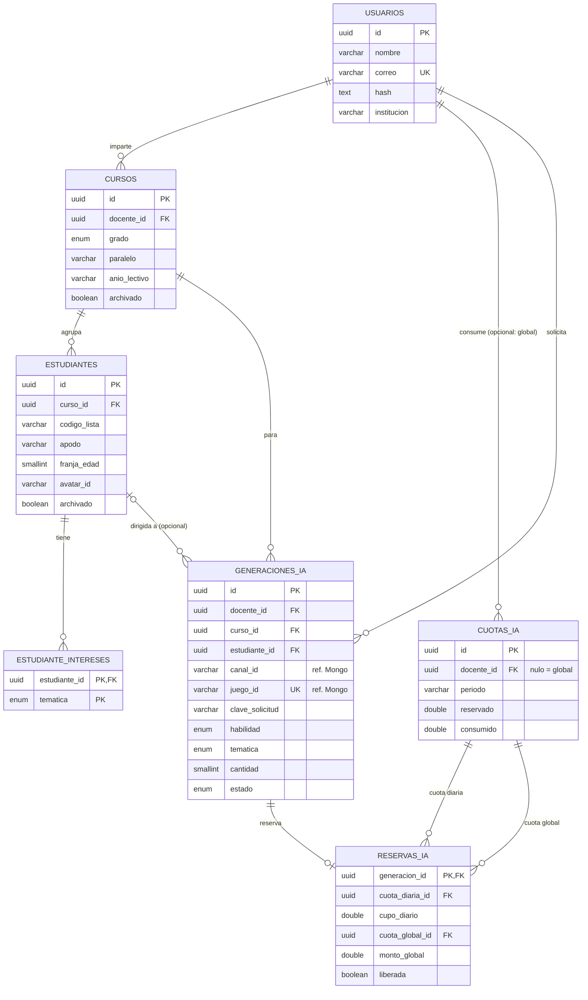
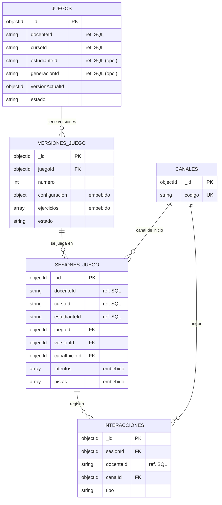

# Servidor v2 — persistencia code first (PostgreSQL + MongoDB)

Segunda versión del servidor de la plataforma de minijuegos educativos con IA. Sigue estrictamente el marco
**HX-ODM-JS** (arquitectura hexagonal por módulos) y usa **dos bases de datos**:

| Motor | Herramienta | Módulos |
|---|---|---|
| PostgreSQL | Sequelize 6 | `Docente`, `Aula` (curso, estudiante), `Generacion` (generación, reserva, cuota) |
| MongoDB | Mongoose 8 | `Juego` (juego, versión), `Partida`, `Canal` (canal, interacción) |

## Code first

Los **modelos son la única fuente de verdad del esquema**. No hay migraciones, ni DDL escrito a mano, ni `$jsonSchema`.

- `Sequelize.js` → `connection()` llama a `sequelize.sync()`: crea las tablas, claves foráneas, enums e índices declarados en los modelos.
- `Mongo.js` → `connection()` llama a `Model.init()` de cada modelo: crea las colecciones e índices declarados en los esquemas.
- `cargarModelos.js` carga todos los `*Model.js` de `src/lib/*/Infraestructura/` antes de sincronizar, incluso los de módulos que aún no exponen rutas.
- Como `ddl-auto=update` de Hibernate (proyecto campeonato), `connection()` usa `sync({ alter: true })`: crea lo que falta y ajusta las tablas existentes a los modelos sin perder datos. En producción poner `SQL_SYNC_ALTER=false` para que solo cree lo que falta. La base de PostgreSQL debe existir antes de arrancar (MongoDB crea la suya sola).

## Estructura (idéntica al marco)

```text
index.js
src/
├── server.js                      conecta PostgreSQL y MongoDB antes de listen
├── app.js                         buildApp(): middlewares, módulos, 404 y manejador de errores
├── Infraestructura/
│   ├── database/{Mongo.js, Sequelize.js, cargarModelos.js}
│   └── http/{envolverAsync.js, requerirDocente.js}   async seguro en Express 4 e identificación provisional del docente
└── lib/
    ├── Compartido/Dominio/{Errores, ValoresPermitidos.js, Validaciones.js}
    └── <Modulo>/
        ├── Dominio/{Entidades, Ports}
        ├── Aplicacion/            un caso de uso por archivo
        └── Infraestructura/       <X>Model.js, <X>Repository{Sequelize|Mongoose}.js, http/{Controller, Routes, index}
```

Regla de dependencias: `Dominio` solo importa `Dominio` (y `validator`); `Aplicacion` no importa `Infraestructura`, `express`, `mongoose` ni `sequelize`
(lo comprueba `tests/arquitectura/capas.test.js`). Los puertos y las entidades son los mismos con independencia del motor.

## API (CRUD en todos los módulos)

Hasta que exista la sesión, el docente se identifica con la cabecera `x-docente-id` (excepto `POST /api/docentes` y `GET /api/canales`, que son públicos).
Cada docente solo ve y modifica sus propios datos. No hay borrado físico salvo en docentes: "eliminar" archiva, descarta, cancela o abandona según el recurso.

| Recurso | Rutas | `DELETE` hace |
|---|---|---|
| Docente (PostgreSQL) | `POST /api/docentes` (público), `GET /api/docentes` (solo la cuenta propia), `GET/PUT/DELETE /api/docentes/:id` (solo la cuenta propia) | borra la cuenta propia si no tiene datos (409 si los tiene) |
| Curso (PostgreSQL) | `POST/GET /api/cursos`, `GET/PUT/DELETE /api/cursos/:id` | archiva |
| Estudiante (PostgreSQL) | `POST/GET /api/estudiantes?cursoId=`, `GET/PUT/DELETE /api/estudiantes/:id` | archiva |
| Juego (MongoDB) | `POST/GET /api/juegos`, `GET/PUT/DELETE /api/juegos/:id`, `POST /api/juegos/:id/desarchivar` | archiva |
| Versión (MongoDB) | `POST/GET /api/juegos/:juegoId/versiones`, `GET/PUT/DELETE .../:id`, `POST .../:id/aprobar` | descarta un borrador (una aprobada es inmutable) |
| Generación (PostgreSQL) | `POST/GET /api/generaciones` (cabecera `Idempotency-Key`), `GET/DELETE /api/generaciones/:id` | cancela una generación activa; no se edita |
| Cuota (PostgreSQL) | `GET /api/cuotas?dia=` (consumo diario propio) | solo lectura: la modifica el flujo de generación; el contador global no se expone |
| Partida (MongoDB) | `POST/GET /api/partidas`, `GET/DELETE /api/partidas/:id`, `POST .../:id/intentos`, `.../pistas`, `.../finalizar` | abandona una partida en curso |
| Interacción (MongoDB) | `POST/GET /api/interacciones?sesionId=` | append-only: no se edita ni se elimina |
| Canal (MongoDB) | `GET /api/canales`, `GET /api/canales/:codigo` | catálogo fijo de 4 canales: solo lectura |

Reglas que aplican los casos de uso: el servidor evalúa los intentos (el cliente solo envía la elección), una partida solo se inicia sobre un juego con versión aprobada, un solo borrador de versión por juego,
el curso/estudiante de un juego o partida deben ser del docente (se comprueba en PostgreSQL antes de escribir en MongoDB) y las solicitudes de generación son idempotentes por clave.
Pendiente conocido (revisión de código): cancelar una generación con reserva de cuota aún no la libera y las solicitudes activas no tienen tope; ambos dependen del flujo de generación. La llamada al proveedor de IA y el control de cupos de la generación quedan para el sprint de generación; hoy `POST /api/generaciones` registra la solicitud en estado `pendiente`.

## Cómo arrancar

```bash
npm install
cp .env.example .env      # SQL_URL, MONGO_URI y las bases de pruebas
npm run dev
npm test                  # necesita SQL_URL_TEST y MONGO_URI_TEST (nombres con "test")
```

Sin las variables de pruebas, las pruebas de base de datos se **omiten con un mensaje explícito**; nunca pasan en falso.

## Normalización (parte PostgreSQL)

- **1FN:** sin listas en columnas; los intereses del estudiante viven en `estudiante_intereses`.
- **2FN:** claves primarias simples (UUID); la única compuesta no tiene atributos.
- **3FN:**
  - `estudiantes` no guarda el docente: es el dueño de su curso (la consulta por docente une con `cursos`).
  - La mecánica no se guarda: se deduce de la habilidad en el Dominio.
  - La reserva de cuota es una tabla propia (`reservas_ia`) que apunta a los dos contadores; los periodos salen de ellos.
  - `cuotas_ia` usa `docente_id` nulo para el contador global (dos índices parciales únicos) en lugar de un texto `docente:<id>`.
- `generaciones_ia.docente_id` se conserva porque expresa quién solicita (clave de idempotencia con `clave_solicitud`), no el dueño del curso.

MongoDB es documental a propósito: ejercicios, intentos y pistas van embebidos, y los ids relacionales (`docenteId`, `cursoId`, `estudianteId`, `generacionId`) se guardan como texto UUID.

## Diagramas

### PostgreSQL



### MongoDB



Entre PostgreSQL y MongoDB no hay claves foráneas ni transacciones: la existencia y pertenencia de los ids se comprueba en `Aplicacion`
(por ejemplo `CrearJuego` verifica que el curso sea del docente) y el flujo generación → juego se recupera con un caso de uso de conciliación (pendiente).
