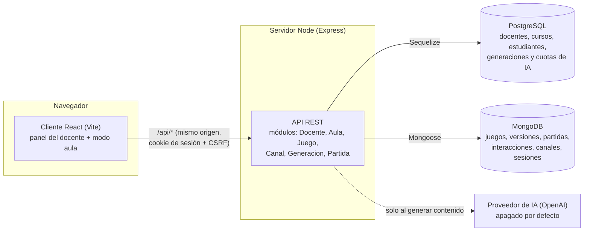
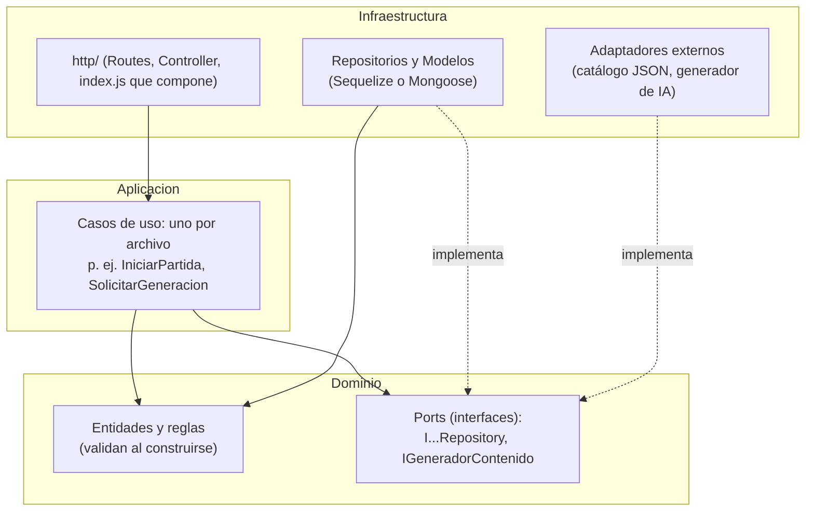
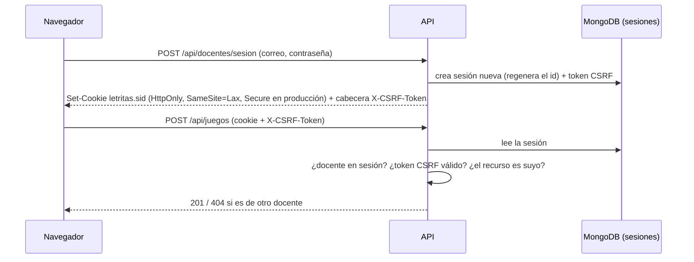
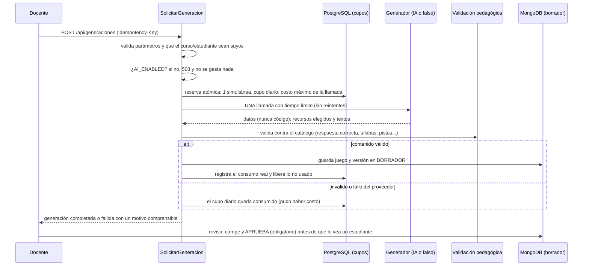
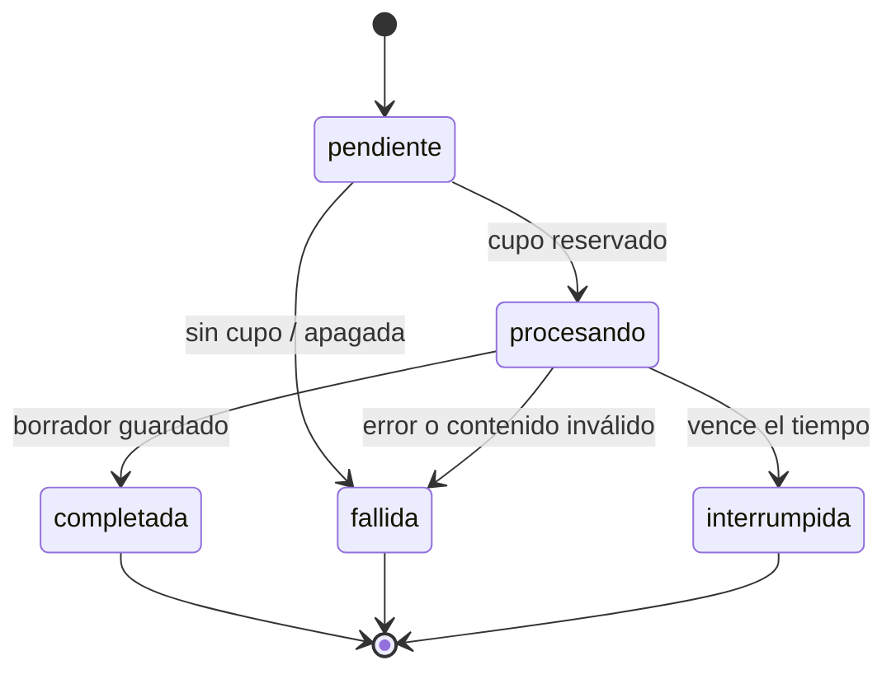

# Arquitectura

Para entender el proyecto y poder explicarlo: **frontend, API, datos e IA**. Los diagramas usan Mermaid (se ven en GitHub y en
la mayoría de editores). Describen el código tal como está; el detalle por archivo está en `server-v2/README.md`.

## 1. Vista general

- **Dos bases a propósito.** PostgreSQL para lo que necesita claves foráneas, unicidad y operaciones atómicas por fila (cuentas, cursos, estudiantes y **control de IA**: cupos y reservas). MongoDB para documentos que se leen enteros (juegos con sus ejercicios, partidas con sus intentos). Los ids de PostgreSQL se guardan como texto en MongoDB; no hay claves foráneas entre motores, así que **la propiedad se comprueba en la aplicación** antes de escribir.
- **Mismo origen.** El cliente llama a `/api` con rutas relativas y la cookie es `SameSite=Lax`: en desarrollo lo hace el proxy de Vite y en producción debe hacerlo un proxy (ver `despliegue.md`).
- **La IA solo participa al generar.** Jugar, ver resultados o repetir una actividad no llaman al proveedor.

## 2. Capas de cada módulo (arquitectura hexagonal)

Reglas que verifica `tests/arquitectura/capas.test.js` (si se rompen, la prueba falla):
- `Dominio` solo importa `Dominio` y `validator`.
- `Aplicacion` no importa `Infraestructura`, `express`, `mongoose` ni `sequelize`; entre módulos solo importa `Dominio`.
- `Infraestructura` no importa `Aplicacion` ni `Infraestructura` ajenas (solo `http/index.js` compone).
- No hay ciclos entre módulos.

**Cambiar un motor o un proveedor toca solo `Infraestructura`.** Por ejemplo, pasar del generador falso al de IA cambia solo `crearGenerador()` en `Generacion/Infraestructura/http/index.js`.

## 3. Módulos

| Módulo | Qué hace | Datos | Rutas principales |
|---|---|---|---|
| Docente | Registro, sesión, cuenta | PostgreSQL | `/api/docentes` |
| Aula | Cursos y estudiantes (códigos de lista, sin nombres completos) | PostgreSQL | `/api/cursos`, `/api/estudiantes` |
| Juego | Actividades, versiones (borrador → aprobada, inmutable), catálogo de recursos | MongoDB | `/api/juegos`, `/api/recursos` |
| Partida | Jugar: iniciar, intentos evaluados **en el servidor**, pistas, resultados, inicio del docente | MongoDB | `/api/partidas`, `/api/resultados`, `/api/inicio` |
| Generacion | Pedir una actividad a la IA con cupo y presupuesto; conciliación | PostgreSQL (+ borrador en MongoDB) | `/api/generaciones`, `/api/cuotas` |
| Canal | Origen de cada acción (docente/aula × computador/tableta) | MongoDB | `/api/canales` |

El cliente tiene la misma estructura (`client/src/lib/<Módulo>/{Dominio, Aplicacion, Infraestructura}`): llamadas HTTP, hooks y pantallas por módulo.

## 4. Seguridad y sesión

- La identidad sale **solo de la sesión**, nunca de un dato que envíe el cliente. Un id ajeno responde 404.
- La sesión vive en MongoDB (sobrevive a reinicios) y caduca a las 4 h sin actividad o 12 h en total.
- El cliente **nunca recibe respuestas correctas antes de contestar**: el servidor evalúa cada intento y la retroalimentación sale de textos fijos del servidor, no de la IA.

## 5. Generación con IA

Puntos que conviene saber explicar:
- La IA **elige recursos del catálogo y redacta consignas y pistas**; el servidor arma los ids, las opciones y las sílabas. Aunque el modelo invente algo, la validación lo rechaza.
- **Idempotencia:** la misma `Idempotency-Key` devuelve la misma generación (restricción única por docente en PostgreSQL); doble clic no gasta dos veces.
- **Conciliación al arrancar y al consultar:** una caída entre pasos no duplica el borrador ni deja reservas colgadas; las vencidas pasan a `interrumpida` sin reintentar.

## 6. Partida y versiones

- Una actividad tiene versiones: **borrador → aprobada**. Una versión aprobada **no se modifica**; editar crea una versión nueva.
- Una partida **congela la versión** con la que empezó: lo jugado antes conserva su contenido aunque se publique otra versión.
- Cada ejercicio admite 2 intentos; al segundo fallo se muestra la solución y se avanza. Las operaciones llevan un `operacionId`: reenviar la misma no cuenta dos veces.
- Solo una partida «en curso» por estudiante y actividad (índice único parcial en MongoDB).
